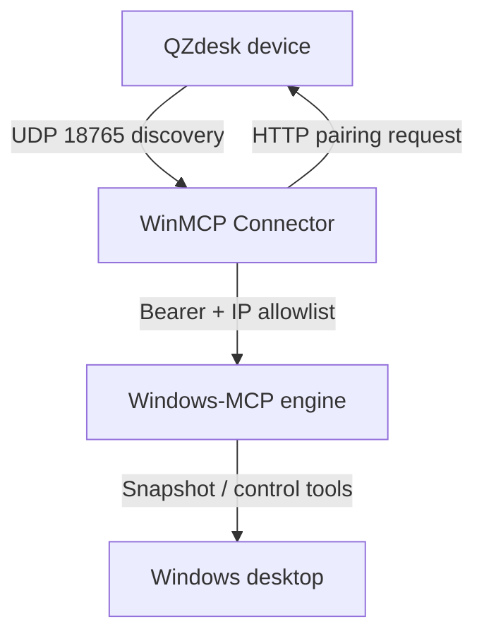

# WinMCP Connector

<div align="center">


</div>

<p align="center">
🇨🇳 <a href="./README.md">简体中文</a> | 🇺🇸 <a href="./README.en.md">English</a>
</p>

WinMCP Connector is an unofficial Windows desktop connector. It exposes local desktop capabilities to a QZdesk device on the same LAN through [Windows-MCP](https://github.com/CursorTouch/Windows-MCP), with device discovery, pairing, a per-session access key, and opt-in control.

> [!IMPORTANT]
> This connector is intended for trusted LANs. It uses HTTP without TLS by default. Do not expose port 8000 to the public internet.

## Table of Contents

- [Features](#features)
- [How It Works](#how-it-works)
- [Requirements](#requirements)
- [Installation](#installation)
- [Usage](#usage)
- [API Reference](#api-reference)
- [Security](#security)
- [Project Structure](#project-structure)
- [Troubleshooting](#troubleshooting)
- [Roadmap](#roadmap)
- [Contributing](#contributing)
- [License](#license)

## Features

- **LAN discovery**: Find QZdesk devices on the same subnet with a UDP broadcast.
- **Pairing approval**: Confirm a verification code on the device before any access is granted.
- **Per-session key**: Generate a random Bearer token at startup; it expires when the session ends.
- **Least privilege**: Start with `Snapshot` only, then enable interaction tools after the device approves control.
- **Auditable logs**: Write runtime logs locally and redact the access key in the log viewer.
- **One-command packaging**: Build a Windows release directory that includes the MCP engine.

## How It Works

<!-- Experimental: if rendering fails, preview on GitHub -->


1. The connector broadcasts `QZDESK_DISCOVER_V1` and the QZdesk device replies with its pairing port.
2. The connector generates a random token, calls the device pairing API, and displays the verification code.
3. After approval, the connector starts the Windows-MCP engine with `streamable-http`.
4. The device calls tools through `http://<PC_IP>:8000/mcp`; every request requires the Bearer token.
5. When access stops or the app exits, the engine process and token become invalid.

## Requirements

| Component | Requirement |
| --- | --- |
| Operating system | Windows 10/11 |
| Release package | No Python installation required, but keep the `engine` directory intact |
| Source build | Python 3.14 with Tcl/Tk |
| MCP engine | A sibling [Windows-MCP](https://github.com/CursorTouch/Windows-MCP) source checkout |
| Qt UI (optional) | CMake 3.21+, Qt 6.5+ (Widgets, Network) |

## Installation

### Use the Built Package

After building, run:

```powershell
.\dist\QZdeskConnector\QZdeskConnector.exe
```

`QZdeskConnector.exe` requires `engine\QZdeskMcpEngine.exe` in the same release directory. Distribute the whole `dist\QZdeskConnector` folder instead of copying only the executable.

### Build from Source

<details>
<summary>Windows one-command build</summary>

`build.ps1` expects `Windows-MCP` and `winmcp-connector` to be siblings:

```text
parent/
├── Windows-MCP/
└── winmcp-connector/
```

```powershell
cd parent
git clone https://github.com/CursorTouch/Windows-MCP.git
git clone https://github.com/QZzwj/winmcp-connector.git
cd winmcp-connector
powershell -ExecutionPolicy Bypass -File build.ps1
```

The script performs the following steps:

1. Create `.venv` and install `requirements.txt`.
2. Force-install the sibling `Windows-MCP` source.
3. Validate the Windows-MCP CLI entry point and Tcl/Tk.
4. Package the UI and MCP engine with PyInstaller.
5. Create `QZdeskConnector-Windows.zip`.

</details>

> [!WARNING]
> `requirements.txt` pins PyPI `windows-mcp==0.8.8`, but `build.ps1` replaces it with the sibling source checkout. The sibling checkout is what gets packaged, so make sure it is on the revision or branch you intend to ship.

### Build the Qt UI (Optional)

`main.cpp` provides a Qt UI that does not depend on Python. It requires manually entered IP addresses and does not implement discovery or pairing.

```bash
cmake -S . -B build-qt -DCMAKE_BUILD_TYPE=Release
cmake --build build-qt --config Release
```

## Usage

1. Put the Windows PC and the QZdesk device on the same LAN.
2. Start `QZdeskConnector.exe` and wait for the device list.
3. Select the target device and click **连接设备 (Connect Device)**.
4. Compare the verification code on the QZdesk screen and approve the request.
5. Copy the endpoint and access key shown by the connector into the QZdesk configuration.
6. Choose whether to grant control on the device, then click **停止访问 (Stop Access)** when finished.

The connector creates the connection parameters after pairing:

| Parameter | Value |
| --- | --- |
| MCP endpoint | `http://<PC_IP>:8000/mcp` |
| Authentication | `Authorization: Bearer <TOKEN>` |
| Initial scope | `Snapshot` only |
| Approved scope | `Snapshot`, `Click`, `Type`, `Scroll`, `Move`, `Shortcut`, `App`, `ControlStatus` |
| Local log | `%LOCALAPPDATA%\QZdeskConnector\server.log` |

> [!NOTE]
> Windows Firewall may prompt for network access the first time. Allow private networks only; do not add a public inbound rule.

## API Reference

### MCP Engine Arguments

The connector starts the engine with these arguments:

| Argument | Description |
| --- | --- |
| `serve --transport streamable-http` | Use MCP Streamable HTTP transport |
| `--host <PC_IP>` | Bind to the PC LAN IPv4 address |
| `--port 8000` | Listening port |
| `--auth-key <TOKEN>` | Random Bearer token created for each session |
| `--ip-allowlist <DEVICE_IP>` | Allow only the paired device |
| `--tools <LIST>` | Restrict callable MCP tools |
| `--no-control` / `--control` | Switch between read-only and approved control mode |

### Tools

| Tool | Initial state | Description |
| --- | --- | --- |
| `Snapshot` | Enabled | Read desktop state, windows, and interactive elements |
| `Click` | After approval | Click at the specified coordinates |
| `Type` | After approval | Type text into the focused element |
| `Scroll` | After approval | Scroll a window or region |
| `Move` | After approval | Move the mouse or drag |
| `Shortcut` | After approval | Send keyboard shortcuts |
| `App` | After approval | Launch, switch, and manage application windows |
| `ControlStatus` | After approval | Query the current control state |

### Environment Variables

`engine.py` sets these variables before starting the engine:

| Variable | Value | Purpose |
| --- | --- | --- |
| `ANONYMIZED_TELEMETRY` | `false` | Disable anonymous telemetry |
| `WINDOWS_MCP_PROFILE_SNAPSHOT` | `1` | Emit Snapshot stage timing logs |
| `WINDOWS_MCP_CONTROL_PUSH` | `false` | Disable engine-initiated control state pushes |

### Example Request

```bash
curl -X POST http://<PC_IP>:8000/mcp \
  -H "Authorization: Bearer <TOKEN>" \
  -H "Content-Type: application/json" \
  -H "Accept: application/json, text/event-stream" \
  -d '{"jsonrpc":"2.0","id":1,"method":"tools/list"}'
```

## Security

> [!CAUTION]
> Control tools can operate the mouse, keyboard, and applications. Enable them only on trusted LANs, devices, and accounts.

- The access key is regenerated at startup and is redacted from the log viewer.
- The IP allowlist accepts only the paired device address; the connector refuses to start on non-private networks.
- The engine starts with `--no-control` and switches to `--control` only after the device approves.
- TLS is not provided. If access must cross a public network, add a VPN or an HTTPS reverse proxy.

## Project Structure

| Path | Description |
| --- | --- |
| `connector.py` | Main UI, device discovery, pairing, and engine lifecycle |
| `engine.py` | Packaging wrapper around the `windows-mcp` CLI entry point |
| `QZdeskConnector.spec` | PyInstaller configuration for the UI |
| `QZdeskMcpEngine.spec` | PyInstaller configuration for the MCP engine |
| `build.ps1` | Windows one-command build script |
| `main.cpp` / `CMakeLists.txt` | Qt UI implementation |
| `UI_OPTIMIZATION_SUMMARY.md` | UI redesign notes |

## Troubleshooting

### Port 8000 Is Already in Use

Click **停止访问 (Stop Access)** in the old window and close the previous connector. If the port is still busy, end any remaining `QZdeskMcpEngine.exe` process in Task Manager. Do not run two connectors at the same time.

### No QZdesk Device Is Found

Confirm that both devices are on the same subnet, that the firewall allows private network access, and that UDP 18765 broadcasts are permitted. Some enterprise Wi-Fi networks isolate clients; use a wired network or ask the administrator to allow it.

### The MCP Engine Is Missing

The release must contain the `engine` directory. Use the complete `QZdeskConnector-Windows.zip` instead of copying only the executable.

### Python Reports a Tcl/Tk Build Error

Reinstall Python 3.14 and select the Tcl/Tk component in the installer.

## Roadmap

- [x] LAN discovery and pairing
- [x] Read-only and approved control modes
- [x] PyInstaller packaging
- [ ] Consolidate the `winmcp-connector` name and executable names
- [ ] Add an open-source license
- [ ] Add CI build and release-package validation
- [ ] Add an English UI

## Contributing

Issues and pull requests are welcome. Before submitting, run `build.ps1` to verify the Windows build and make sure `.venv`, `build`, `dist`, `engine-dist`, `ui-dist`, logs, and release zip files are not committed.

## License

This project does not include a `LICENSE` file yet; the license is pending maintainer confirmation. The upstream [Windows-MCP](https://github.com/CursorTouch/Windows-MCP) project is MIT licensed. Release packages that bundle the engine must retain its license and copyright notice.
