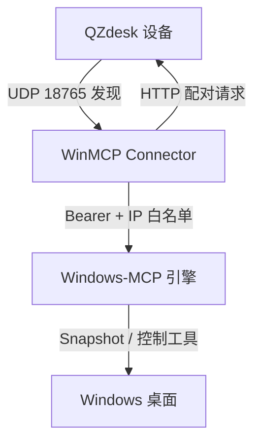

# WinMCP Connector

<div align="center">


</div>

<p align="center">
🇨🇳 <a href="./README.md">简体中文</a> | 🇺🇸 <a href="./README.en.md">English</a>
</p>

WinMCP Connector 是一个非官方的 Windows 桌面连接器。它把本机桌面能力通过 [Windows-MCP](https://github.com/CursorTouch/Windows-MCP) 暴露给同一局域网内的 QZdesk 设备，并提供设备发现、配对确认、随机访问密钥和按需授权控制。

> [!IMPORTANT]
> 该连接器面向可信局域网。默认使用 HTTP 且不启用 TLS，请勿把 8000 端口映射到公网。

## 目录

- [功能特性](#功能特性)
- [工作原理](#工作原理)
- [环境要求](#环境要求)
- [安装](#安装)
- [使用](#使用)
- [API 参考](#api-参考)
- [安全说明](#安全说明)
- [项目结构](#项目结构)
- [常见问题](#常见问题)
- [路线图](#路线图)
- [贡献](#贡献)
- [许可证](#许可证)

## 功能特性

- **局域网发现**：通过 UDP 广播自动发现同一网段的 QZdesk 设备。
- **配对确认**：在设备端核对校验码并授权，超时后自动取消。
- **按次生成密钥**：每次启动随机生成 Bearer token，连接结束后立即失效。
- **最小权限**：默认只开放 `Snapshot`，设备确认控制请求后才启用交互工具。
- **可审计日志**：运行日志写入本地目录，界面显示时会隐藏访问密钥。
- **一键打包**：PyInstaller 生成包含 MCP 引擎的 Windows 发行目录。

## 工作原理

<!-- Experimental: if rendering fails, preview on GitHub -->


1. 连接器向局域网广播 `QZDESK_DISCOVER_V1`，QZdesk 回复配对服务端口。
2. 连接器生成随机 token，调用设备端的配对接口并显示校验码。
3. 设备端确认后，连接器以 `streamable-http` 方式启动 Windows-MCP 引擎。
4. 设备通过 `http://<PC_IP>:8000/mcp` 调用工具，所有请求都需要 Bearer token。
5. 用户停止访问或退出程序后，引擎进程和本次 token 一起失效。

## 环境要求

| 组件 | 要求 |
| --- | --- |
| 操作系统 | Windows 10/11 |
| 运行发行包 | 无需安装 Python，但必须保留完整的 `engine` 目录 |
| 源码构建 | Python 3.14，安装时必须包含 Tcl/Tk |
| MCP 引擎 | 与项目目录同级的 [Windows-MCP](https://github.com/CursorTouch/Windows-MCP) 源码 |
| Qt 版界面（可选） | CMake 3.21+、Qt 6.5+（Widgets、Network） |

## 安装

### 使用构建产物

构建完成后，直接运行：

```powershell
.\dist\QZdeskConnector\QZdeskConnector.exe
```

`QZdeskConnector.exe` 依赖同目录下的 `engine\QZdeskMcpEngine.exe`。分发时应整体打包 `dist\QZdeskConnector`，不要只复制单个 exe 文件。

### 从源码构建

<details>
<summary>Windows 一键构建步骤</summary>

`build.ps1` 要求 `Windows-MCP` 与 `winmcp-connector` 位于同一个父目录：

```text
parent/
├── Windows-MCP/
└── winmcp-connector/
```

```powershell
cd parent
git clone https://github.com/CursorTouch/Windows-MCP.git
git clone https://github.com/QZzwj/winmcp-connector.git
cd winmcp-connector
powershell -ExecutionPolicy Bypass -File build.ps1
```

脚本会依次执行以下操作：

1. 创建 `.venv` 并安装 `requirements.txt`。
2. 强制安装同级的 `Windows-MCP` 源码。
3. 验证 Windows-MCP 命令行入口和 Tcl/Tk。
4. 使用 PyInstaller 打包界面和 MCP 引擎。
5. 生成 `QZdeskConnector-Windows.zip`。

</details>

> [!WARNING]
> `requirements.txt` 固定了 PyPI 上的 `windows-mcp==0.8.8`，但 `build.ps1` 随后会用同级源码覆盖安装。最终打包进发行包的是同级 `Windows-MCP` 目录的版本，请确保该目录处于你期望的提交或分支。

### 构建 Qt 版界面（可选）

`main.cpp` 提供不依赖 Python 的 Qt 界面，需要手动填写电脑 IP 和设备 IP，不包含设备发现与配对流程。

```bash
cmake -S . -B build-qt -DCMAKE_BUILD_TYPE=Release
cmake --build build-qt --config Release
```

## 使用

1. 确保 Windows 电脑和 QZdesk 设备处于同一局域网。
2. 启动 `QZdeskConnector.exe`，等待设备列表出现。
3. 选择目标设备并点击 **连接设备**。
4. 在 QZdesk 设备屏幕上核对校验码并确认授权。
5. 连接成功后，复制界面显示的连接地址和访问密钥，填入 QZdesk 配置。
6. 设备端选择是否授予控制权限；完成后点击 **停止访问**。

连接参数由程序在配对成功后生成：

| 参数 | 值 |
| --- | --- |
| MCP 地址 | `http://<PC_IP>:8000/mcp` |
| 认证方式 | `Authorization: Bearer <TOKEN>` |
| 初始权限 | 仅 `Snapshot` |
| 授权后权限 | `Snapshot`、`Click`、`Type`、`Scroll`、`Move`、`Shortcut`、`App`、`ControlStatus` |
| 本地日志 | `%LOCALAPPDATA%\QZdeskConnector\server.log` |

> [!NOTE]
> Windows 防火墙可能首次弹出网络访问提示。只允许专用网络访问，不要开放公用网络入站规则。

## API 参考

### MCP 引擎参数

连接器启动引擎时使用以下参数：

| 参数 | 说明 |
| --- | --- |
| `serve --transport streamable-http` | 使用 MCP Streamable HTTP 传输 |
| `--host <PC_IP>` | 绑定电脑的局域网 IPv4 地址 |
| `--port 8000` | 监听端口 |
| `--auth-key <TOKEN>` | 每次启动随机生成的 Bearer token |
| `--ip-allowlist <DEVICE_IP>` | 只允许已配对设备访问 |
| `--tools <LIST>` | 限制可调用的 MCP 工具 |
| `--no-control` / `--control` | 切换只读模式与授权控制模式 |

### 工具列表

| 工具 | 初始状态 | 说明 |
| --- | --- | --- |
| `Snapshot` | 启用 | 读取桌面状态、窗口和可交互元素 |
| `Click` | 授权后 | 在指定坐标点击 |
| `Type` | 授权后 | 向当前焦点元素输入文本 |
| `Scroll` | 授权后 | 滚动窗口或指定区域 |
| `Move` | 授权后 | 移动鼠标或拖拽 |
| `Shortcut` | 授权后 | 发送键盘快捷键 |
| `App` | 授权后 | 启动、切换和管理应用窗口 |
| `ControlStatus` | 授权后 | 查询当前控制状态 |

### 环境变量

`engine.py` 在启动引擎前设置以下环境变量：

| 变量 | 值 | 用途 |
| --- | --- | --- |
| `ANONYMIZED_TELEMETRY` | `false` | 关闭匿名遥测 |
| `WINDOWS_MCP_PROFILE_SNAPSHOT` | `1` | 输出 Snapshot 阶段耗时日志 |
| `WINDOWS_MCP_CONTROL_PUSH` | `false` | 关闭引擎主动推送控制状态 |

### 调用示例

```bash
curl -X POST http://<PC_IP>:8000/mcp \
  -H "Authorization: Bearer <TOKEN>" \
  -H "Content-Type: application/json" \
  -H "Accept: application/json, text/event-stream" \
  -d '{"jsonrpc":"2.0","id":1,"method":"tools/list"}'
```

## 安全说明

> [!CAUTION]
> 控制类工具可以操作鼠标、键盘和应用程序。只在可信局域网、可信设备和可信账号环境中启用。

- 访问密钥在每次启动时重新生成，不会写入日志查看界面。
- IP 白名单只接受已配对的设备地址，连接器拒绝启动于非私有网段。
- 默认以 `--no-control` 启动，设备端明确授权后才切换到 `--control`。
- 不提供 TLS；如果必须跨公网使用，请在网络层增加 VPN 或 HTTPS 反向代理。

## 项目结构

| 路径 | 说明 |
| --- | --- |
| `connector.py` | 主界面、设备发现、配对流程和引擎生命周期管理 |
| `engine.py` | 加载 `windows-mcp` 命令行入口的打包包装 |
| `QZdeskConnector.spec` | 界面程序的 PyInstaller 配置 |
| `QZdeskMcpEngine.spec` | MCP 引擎的 PyInstaller 配置 |
| `build.ps1` | Windows 一键构建脚本 |
| `main.cpp` / `CMakeLists.txt` | Qt 版界面实现 |
| `UI_OPTIMIZATION_SUMMARY.md` | 界面改版记录 |

## 常见问题

### 端口 8000 被占用

先点击旧窗口的 **停止访问** 并关闭旧连接器；如仍失败，在任务管理器中结束残留的 `QZdeskMcpEngine.exe`。不要同时启动两个连接器。

### 搜索不到 QZdesk 设备

确认两台设备在同一网段、防火墙允许专用网络访问，并允许 UDP 18765 广播通过。部分企业 Wi-Fi 会隔离客户端，此时需要改用有线网络或管理员放行。

### 提示缺少 MCP 引擎

发行包必须包含 `engine` 目录。请使用完整的 `QZdeskConnector-Windows.zip`，不要只复制 exe。

### Python 构建时报 Tcl/Tk 错误

重新安装 Python 3.14，并在安装器中勾选 Tcl/Tk 组件。

## 路线图

- [x] 局域网发现与配对
- [x] 只读模式与授权控制模式
- [x] PyInstaller 一键打包
- [ ] 统一 `winmcp-connector` 命名与可执行文件名称
- [ ] 添加项目开源许可证
- [ ] 增加 CI 构建与发行包校验
- [ ] 补充英文界面

## 贡献

欢迎提交 issue 和 pull request。提交前请先运行 `build.ps1` 验证 Windows 构建，并确保没有提交 `.venv`、`build`、`dist`、`engine-dist`、`ui-dist`、日志或发行 zip。

## 许可证

本项目尚未包含 `LICENSE` 文件，许可证待维护者确认。依赖的 [Windows-MCP](https://github.com/CursorTouch/Windows-MCP) 使用 MIT License；分发包含该引擎的构建产物时，需要保留其许可证和版权声明。
